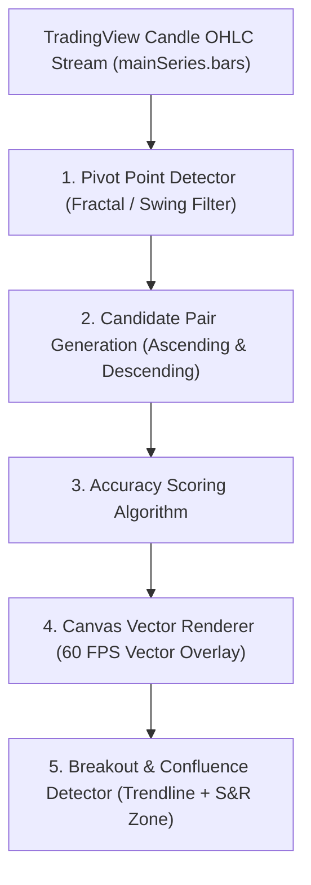

# NSE S&R Pro — Master Future Scope Roadmap

This document outlines the planned future features for the **NSE S&R Pro** Chrome Extension. Each feature is designed to integrate cleanly with the existing architecture without disrupting core functionality.

---

## Table of Contents
1. [Feature 1: Live Strike OI Change Profile Bars (Horizontal Histogram)](#feature-1-live-strike-oi-change-profile-bars-horizontal-histogram)
2. [Feature 2: High-Speed Real-Time Feed via Angel One SmartAPI (1-Second Ticks)](#feature-2-high-speed-real-time-feed-via-angel-one-smartapi-1-second-ticks)
3. [Feature 3: Algorithmic Auto-Trendline Engine (Price Action & Confluence)](#feature-3-algorithmic-auto-trendline-engine-price-action--confluence)

---

## Feature 1: Live Strike OI Change Profile Bars (Horizontal Histogram)

* **Objective:** Render an institutional horizontal Open Interest profile (histogram) anchored flush against the right-side price scale, extending leftward across each strike's horizontal Y-axis coordinate.
* **Full Specification:** See [FUTURE_SCOPE_OI_PROFILE_BARS.md](file:///d:/Projects/NSE%20extension/FUTURE_SCOPE_OI_PROFILE_BARS.md) for full visual and geometric specs.

### Visual Representation
```text
Price Scale Axis (Right Edge) ──────────────────────────┐
                                                         │
25,350.00 ───────[ ████████████ Call ΔOI (+3.2L) ]──────┤ (25,350)
                 [ ████████ Put ΔOI (+1.8L)      ]      │
                                                         │
25,300.00 ───────[ ████████ Call ΔOI (+1.4L)     ]──────┤ (25,300 ATM)
                 [ ██████████████ Put ΔOI (+4.1L)]      │
                                                         │
25,250.00 ───────[ ████ Call ΔOI (+0.6L)         ]──────┤ (25,250)
                 [ ██████████████████ (+5.5L)    ]      │
                                                         │
```

### Key Highlights:
* **Red Bars:** Intraday Call OI Change ($\Delta\text{CE}$ — Call writing / resistance buildup).
* **Green Bars:** Intraday Put OI Change ($\Delta\text{PE}$ — Put writing / support buildup).
* **Relative Scaling:** Max bar length capped at $160\text{px}$–$220\text{px}$ proportional to the highest strike $\Delta\text{OI}$ in the session.
* **On-Demand Activation:** Toggleable via an icon button in the popup header; zero overhead when inactive.

---

## Feature 2: High-Speed Real-Time Feed via Angel One SmartAPI (1-Second Ticks)

* **Objective:** Elevate underlying OI refresh rates from the public web cache (~3 minutes) down to **1-second / tick-by-tick streaming** using Angel One's free SmartAPI WebSocket 2.0.

### Architectural Plan:
* **Dual-Engine / Pluggable Source:**
  * **Engine A (Default):** Public NSE web scraper (zero setup, standalone).
  * **Engine B (Turbo):** Angel One SmartAPI WebSocket 2.0 (1-second updates).
* **Feature-Triggered Streaming:**
  * Keeps the extension lightweight on the public feed by default.
  * When the **OI Profile Bars** feature is toggled ON, the extension activates the Angel One WebSocket stream for the active ATM $\pm 10$ strikes.
  * Both the histogram bars and horizontal S&R lines consume the same live stream, eliminating any "desync / split-brain" discrepancy.

---

## Feature 3: Algorithmic Auto-Trendline Engine (Price Action & Confluence)

* **Objective:** Automatically detect, validate, and plot the most accurate diagonal support and resistance trendlines on TradingView candles with a single click.



### 1. Mathematical Architecture & Accuracy Scoring

The engine processes all intraday bars currently rendered on the active timeframe ($1\text{m}, 3\text{m}, 5\text{m}, 15\text{m}$) using TradingView's exposed `mainSeries.bars()` data:

#### Step 1: Swing Pivot Detection
* Uses a symmetric rolling window $N$ ($N = 3$ to $5$ candles):
  * **Pivot High:** $\text{High}_i > \max(\text{High}_{i-N \dots i-1}) \text{ and } \text{High}_i > \max(\text{High}_{i+1 \dots i+N})$.
  * **Pivot Low:** $\text{Low}_i < \min(\text{Low}_{i-N \dots i-1}) \text{ and } \text{Low}_i < \min(\text{Low}_{i+1 \dots i+N})$.

#### Step 2: Line Construction & Slope Bounds
* Generates candidate lines connecting pivot pairs:
  $$\text{Slope } m = \frac{Y_2 - Y_1}{X_2 - X_1}$$
* **Support Lines:** Connect higher-low or equal-low pivots ($m \ge 0$).
* **Resistance Lines:** Connect lower-high or equal-high pivots ($m \le 0$).
* **Filter:** Rejects unnatural slopes ($< 10^\circ$ is flat horizontal, $> 65^\circ$ is unsustainable parabolic spikes).

#### Step 3: Accuracy Scoring Formula
Each candidate trendline is evaluated against intermediate candles:
$$\text{Score} = (W_{\text{touch}} \times N_{\text{touches}}) + (W_{\text{recency}} \times R) - (W_{\text{violation}} \times V)$$

* **Touch Validation ($+30\text{ pts / touch}$):** Price wick approaches within a tolerance margin ($\le 0.08\%$) of the line.
* **Cleanliness Penalty ($-60\text{ pts / violation}$):** Any candle *closing* on the wrong side of the line heavily penalizes and invalidates the line.
* **Recency Weight ($+20\text{ pts}$):** Recent session bounces carry more predictive weight than early morning touches.

### 2. Canvas Vector Rendering & Extension
* **Color Coding:**
  * **Ascending Support Trendline:** Cyan / Teal (`#26a69a`) with semi-transparent fill zone.
  * **Descending Resistance Trendline:** Coral / Orange-Red (`#ff7043`).
* **Projection & Ray:**
  * Anchored at the earliest valid swing pivot, connects subsequent touches, and projects forward to the current active candle.
* **Touch Markers:**
  * Subtle circular nodes drawn on the exact candle wicks that verified the line, giving visual transparency to why the line was drawn.

### 3. Dynamic Breakout Alerts
* If the live candle body closes across an active trendline:
  * The line color transitions to a dashed/muted state.
  * A small badge flags **"Breakout Confirmed"** on the chart.

### 4. Ultimate Confluence: Trendline + OI S&R
* When an algorithmic diagonal trendline intersects near a key **OI S&R level** (e.g. falling resistance trendline meets **R1: 25,350**):
  * The chart identifies a **High-Probability Rejection Confluence Zone**.
  * Traders receive maximum confirmation before taking mean-reversion or breakout trades.

### 5. UI Controls
* Toggle in the extension popup: **Auto Trendlines [ ON | OFF ]**.
* Floating shortcut pill on the chart: `[ 📐 TL ]` beside `[ ● OI ]`.
* Settings options:
  * **Sensitivity:** Conservative (3+ touches required) vs Responsive (2+ touches).
  * **Style:** Solid ray, dashed projection, or channel boundary.

---

## Implementation Priority Roadmap

| Phase | Milestone | Primary Files Modified |
| :--- | :--- | :--- |
| **Phase 1** | Live Strike OI Profile Bars (Horizontal Histogram) | `background.js`, `content.js`, `popup.html`, `popup.js` |
| **Phase 2** | Angel One SmartAPI WebSocket Integration (1s Real-Time) | `background.js`, `popup.html`, `popup.js` |
| **Phase 3** | Algorithmic Auto-Trendlines & Confluence Detection | `content.js`, `bridge.js`, `popup.html`, `popup.js` | **Completed & Operational** ✅ |
