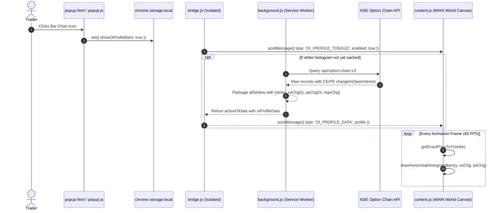

# Future Scope & Development Specification: Live Strike OI Change Profile Bars

**Document Version:** 1.0  
**Feature Name:** Live Strike OI Change Profile (Horizontal Histogram Overlay)  
**Status:** Planned / Future Scope (Ready for Implementation on Request)  
**Target Environment:** TradingView Chart Canvas Overlay (`content.js`, `background.js`, `popup.html`, `popup.js`)  
**Reference Screenshot:** User Upload `media_1794842509100_45fe55a8.jpg`  

---

## 1. Feature Objective & Vision

This feature adds an on-demand, institutional-grade **horizontal Open Interest Profile (Histogram)** to TradingView charts, visually aligned with each strike price on the vertical Y-axis.

Unlike static end-of-day charts, this histogram visualizes **today's live intraday change in Open Interest ($\Delta\text{OI}$)**:
* **Red Bars:** Intraday Call OI Change ($\Delta\text{CE}$ — Call writing / resistance buildup).
* **Green Bars:** Intraday Put OI Change ($\Delta\text{PE}$ — Put writing / support buildup).
* **Positioning:** Anchored flush against the right-hand price scale, extending leftward across each strike's horizontal coordinate line.
* **On-Demand Activation:** Controlled by a single-click Bar Chart Icon in the popup header; completely zero-footprint when turned off.

---

## 2. Visual & Geometric Specifications

```text
Price Scale Axis (Right Edge) ──────────────────────────┐
                                                         │
25,300.00 ───────[ ████████████ Call ΔOI (+3.2L) ]──────┤ (25,300)
                 [ ████████ Put ΔOI (+1.8L)      ]      │
                                                         │
25,250.00 ───────[ ████████ Call ΔOI (+1.4L)     ]──────┤ (25,250)
                 [ ██████████████ Put ΔOI (+4.1L)]      │
                                                         │
25,200.00 ───────[ ████ Call ΔOI (+0.6L)         ]──────┤ (25,200 ATM)
                 [ ██████████████████ (+5.5L)    ]      │
                                                         │
```

### Visual Parameters:
* **Bar Alignment:** Centered vertically around `priceToY(strike)`.
  * Top Half: Call $\Delta\text{OI}$ (Color: `#ef5350` / semi-transparent `#ef5350cc`, height: `7px`).
  * Bottom Half: Put $\Delta\text{OI}$ (Color: `#26a69a` / semi-transparent `#26a69acc`, height: `7px`).
  * Gap between Call and Put bars: `1.5px`.
  * Total strike cluster height: `16px`.
* **Bar Width Scaling:**
  $$\text{Max Bar Width} = 140\text{px} \quad (\text{customizable: } 100\text{px to } 220\text{px})$$
  $$\text{Width}(\text{strike}, \text{type}) = \left( \frac{|\Delta\text{OI}_{\text{strike}, \text{type}}|}{\max_{\text{all strikes}} |\Delta\text{OI}|} \right) \times \text{Max Bar Width}$$
* **Unwinding (Negative $\Delta\text{OI}$):**
  When institutional traders exit positions (negative change in OI), render with hollow/striped or lower-opacity styling (`#ef535055` / `#26a69a55`) with a minus prefix (e.g., `-1.2L`).
* **Text Labels (Optional overlay):**
  Compact contract change text inside or right next to the bar (e.g., `+3.2L`, `+1.8L`).

### 2.1 Response Time & Latency Metrics
* **Canvas Rendering Latency:** $\approx 0\text{ ms}$ (Instantaneous 60–144 FPS). Coordinates recalculate on every `requestAnimationFrame` frame; panning, zooming, and stretching TradingView causes zero visual delay or lag.
* **Underlying Data Update Cadence:** NSE refreshes and disseminates Open Interest snapshots publicly every **~3 to 5 minutes** during market hours (09:15 to 15:30 IST).
* **Extension Background Sync:** Background worker cache evaluates every **45 seconds** (or instantaneously upon manual refresh / ticker switch), reflecting exchange OI updates on the chart within seconds of dissemination.

---

## 3. Architecture & Data Flow



---

## 4. Technical Implementation Blueprint

### Phase 1: Background Data Packaging (`background.js`)
In `calculateOiLevels()`, populate an `oiProfile` payload alongside the existing $R_1 \dots R_3$ and $S_1 \dots S_3$ levels:

```javascript
// Build complete strike histogram profile for the selected range (ATM +/- 10 strikes)
let maxChgAbs = 0;
const profileStrikes = chosenStrikes.map((s) => {
  const item = strikeMap.get(s);
  const ceChg = item ? item.ceChgOi : 0;
  const peChg = item ? item.peChgOi : 0;
  maxChgAbs = Math.max(maxChgAbs, Math.abs(ceChg), Math.abs(peChg));

  return {
    strike: s,
    ceChgOi: ceChg,
    peChgOi: peChg,
    ceOi: item ? item.ceOi : 0,
    peOi: item ? item.peOi : 0,
    ceChgFormatted: formatOI(ceChg),
    peChgFormatted: formatOI(peChg)
  };
});

// Added to returned payload:
return {
  ...existingReturnFields,
  oiProfile: {
    maxChange: maxChgAbs,
    strikes: profileStrikes
  }
};
```

---

### Phase 2: Canvas Rendering Engine (`content.js`)
Add `drawOiProfileBars()` directly into `content.js`'s render loop:

```javascript
let showOiProfileBars = false; // Toggled by user
const MAX_BAR_WIDTH_PX = 130;
const RIGHT_MARGIN_PX = 4;

function drawOiProfileBars(ctx, overlayWidth, profileData, priceToY) {
  if (!showOiProfileBars || !profileData || !profileData.strikes?.length) return;
  const maxChg = profileData.maxChange || 1;

  for (const item of profileData.strikes) {
    const y = priceToY(item.strike);
    if (typeof y !== 'number' || isNaN(y) || y < 0 || y > overlay.height) continue;

    // Calculate bar widths proportional to maximum change
    const ceWidth = Math.max(2, (Math.abs(item.ceChgOi) / maxChg) * MAX_BAR_WIDTH_PX);
    const peWidth = Math.max(2, (Math.abs(item.peChgOi) / maxChg) * MAX_BAR_WIDTH_PX);

    const startX_CE = overlayWidth - RIGHT_MARGIN_PX - ceWidth;
    const startX_PE = overlayWidth - RIGHT_MARGIN_PX - peWidth;

    // 1. Call Bar (Red, Top Half)
    ctx.fillStyle = item.ceChgOi >= 0 ? 'rgba(239, 83, 80, 0.85)' : 'rgba(239, 83, 80, 0.35)';
    ctx.beginPath();
    ctx.roundRect(startX_CE, y - 8, ceWidth, 6.5, [3, 0, 0, 3]);
    ctx.fill();

    // 2. Put Bar (Green, Bottom Half)
    ctx.fillStyle = item.peChgOi >= 0 ? 'rgba(38, 166, 154, 0.85)' : 'rgba(38, 166, 154, 0.35)';
    ctx.beginPath();
    ctx.roundRect(startX_PE, y + 0.5, peWidth, 6.5, [3, 0, 0, 3]);
    ctx.fill();
  }
}
```

---

### Phase 3: Header Toggle Button (`popup.html` & `popup.js`)
Add a dedicated Bar Chart Button in `.theme-toolbar`:

```html
<!-- In popup.html next to the eye icon -->
<button id="toggleProfileBtn" class="icon-toggle-btn" title="Toggle Live Strike OI Profile Bars (Histogram)">
  <svg xmlns="http://www.w3.org/2000/svg" width="14" height="14" viewBox="0 0 24 24" fill="none" stroke="currentColor" stroke-width="2" stroke-linecap="round" stroke-linejoin="round">
    <line x1="18" y1="20" x2="18" y2="10"></line>
    <line x1="12" y1="20" x2="12" y2="4"></line>
    <line x1="6" y1="20" x2="6" y2="14"></line>
  </svg>
</button>
```

In `popup.js`:
```javascript
document.getElementById('toggleProfileBtn')?.addEventListener('click', () => {
  chrome.storage.local.get(['showOiProfileBars'], (res) => {
    const next = !(res.showOiProfileBars === true);
    chrome.storage.local.set({ showOiProfileBars: next });
    updateProfileButtonState(next);
  });
});
```

---

## 5. Real-Time Refresh & Latency Architecture

| Layer | Interval / Frequency | Notes |
| :--- | :--- | :--- |
| **Canvas Redraw** | 60 FPS (`requestAnimationFrame`) | Instantaneous response to chart zoom/pan; 0ms lag. |
| **Exchange Data Refresh** | Every 3 Minutes | Matches NSE's public web dissemination cycle during market hours. |
| **Background Auto-Poller** | Configurable (1 min / 3 min / Off) | Dispatches `FETCH_OI` silently while TradingView tab is active. |
| **Cache Invalidation** | 45-Second In-Memory TTL | Re-queries NSE automatically after 45s when refreshed. |

---

## 6. Checklist for Future Implementation

When instructed to implement this feature:
- [ ] In `background.js`: Add `oiProfile` field containing `{ maxChange, strikes }` into `calculateOiLevels()` return object.
- [ ] In `content.js`: Add `drawOiProfileBars()` function using `priceToY(strike)` and `roundRect`.
- [ ] In `content.js`: Connect message listener for `OI_PROFILE_TOGGLE` and `showOiProfileBars` storage state.
- [ ] In `popup.html`: Add `#toggleProfileBtn` SVG button to `.theme-toolbar`.
- [ ] In `popup.js`: Wire up click listener and dynamic active/muted button states.
- [ ] Test on live TradingView chart across multi-timeframe zoom levels (1m, 5m, 15m).
